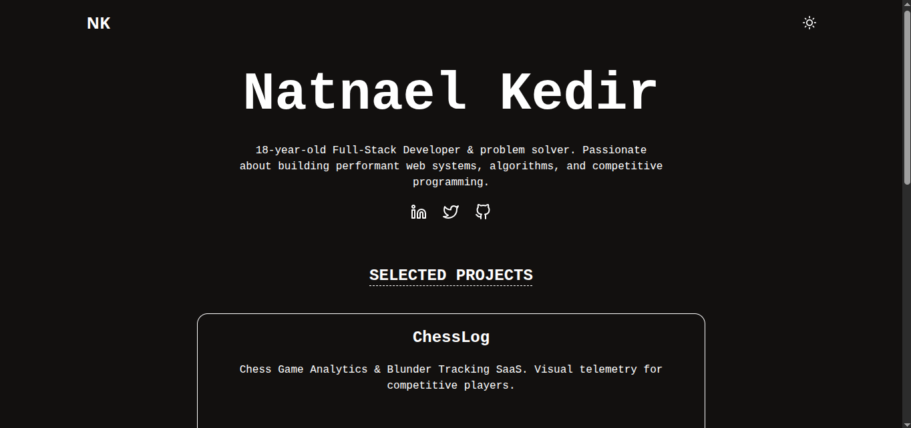

# My portfolio website
A minimalist portfolio website showcasing my projects, experience and a contact form.

Open the link to view the website.

## Features 
- Dark and Light theme
- Shows the projects I have
- A fully functional contact form

## How it works
Formspree allowed me to easily integrate the contact section to capture viewer's response. The website uses react state to allow dark and light theme. Since it also stores the current theme state on localstorage it allows the user to continue on the prefered state even after reloading the page. Tailwind does most of the styling making the website responsive and interactive.

